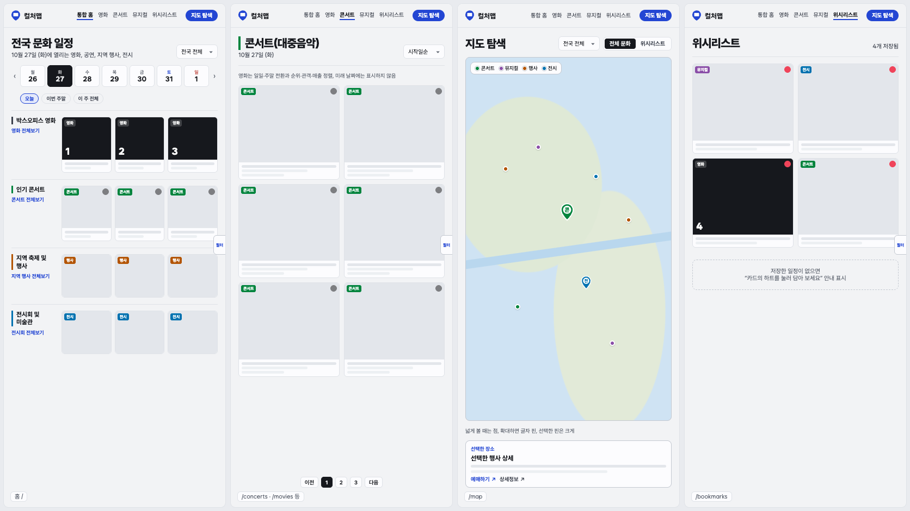
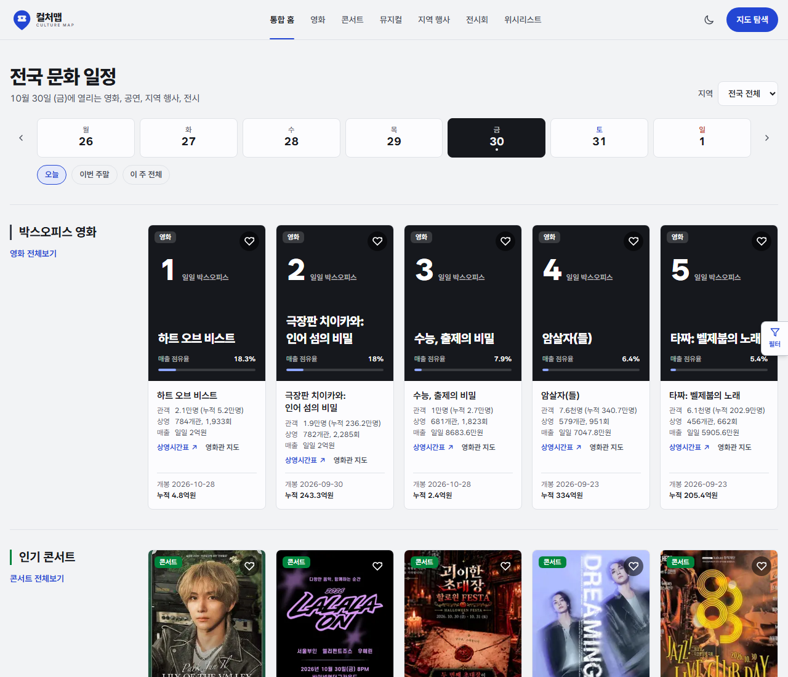
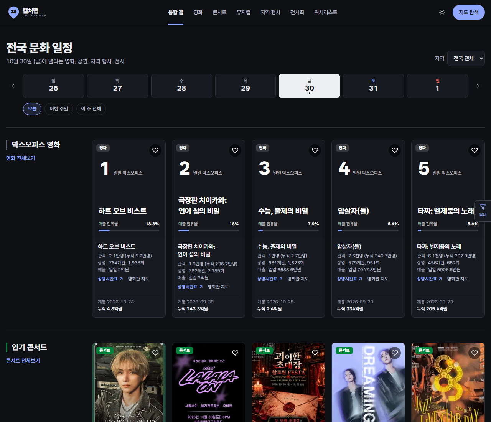
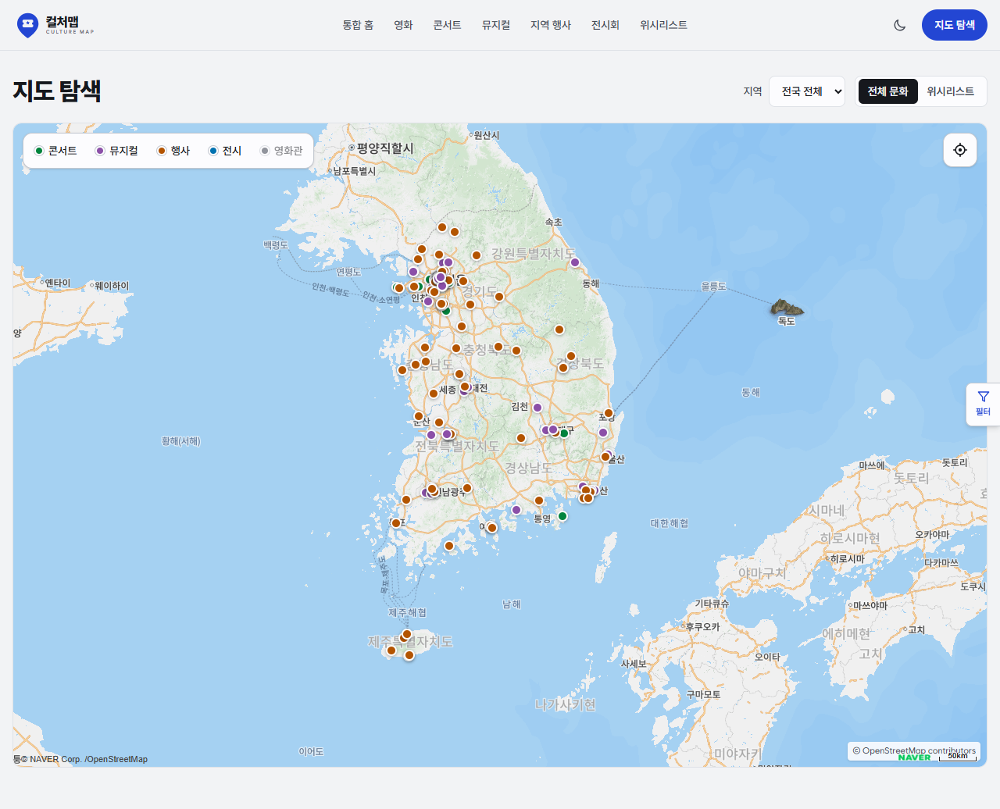
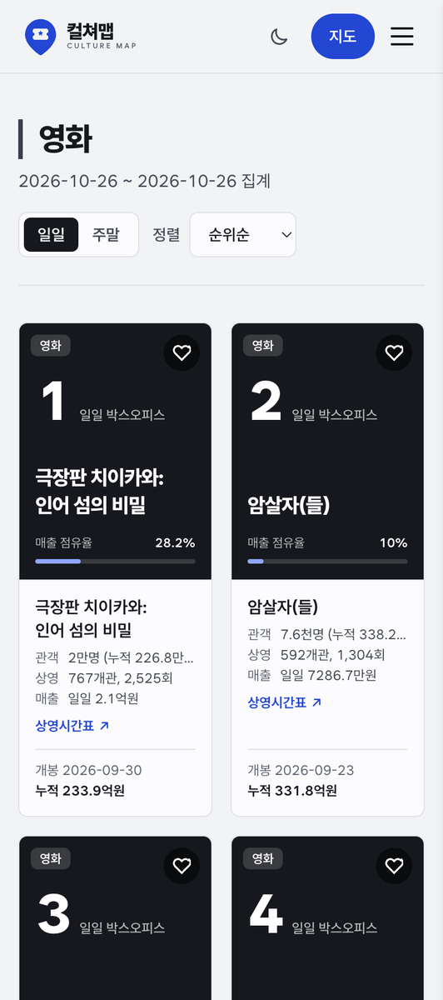
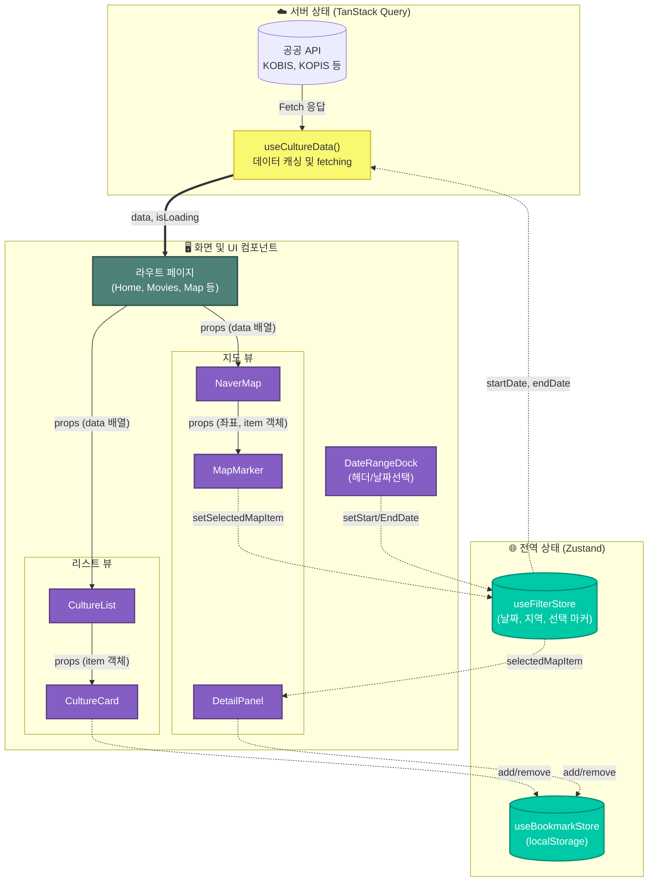

# 컬쳐맵 (Culture Map)

날짜와 지역을 기준으로 영화, 공연, 축제, 전시를 찾아보고 지도에서 장소를 확인하는 문화생활 탐색 서비스입니다.

- **주제:** 문화 행사 통합 검색 및 지도 탐색
- **제작 목적:** 여러 기관의 문화 정보를 한 화면에서 비교하고, 일정에 맞는 장소를 찾을 수 있도록 제작했습니다.
- **주요 사용자:** 영화·공연·축제·전시 일정을 날짜와 지역 기준으로 탐색하려는 사용자
- **개발 기간:** 2026.09.29 ~ 2026.10.01 (이후 2026.10.30까지 기능 개선)
- **배포 주소:** [https://culture-map-pi.vercel.app](https://culture-map-pi.vercel.app)

## 주요 기능

| 페이지 | 기능 |
|---|---|
| `/` | 날짜 범위에 맞는 영화·콘서트·뮤지컬·지역 행사·전시 추천을 모아봅니다. |
| `/movies` | KOBIS 일일/주말 박스오피스의 순위, 관객, 매출, 상영 규모를 카드로 확인하고 네이버 상영시간표 검색이나 지도의 영화관 레이어로 이동합니다. |
| `/concerts` | KOPIS 대중음악 공연 일정, 가격, 예매처와 상세 링크를 확인합니다. |
| `/musicals` | KOPIS 뮤지컬 일정, 가격, 예매처와 상세 링크를 확인합니다. |
| `/festivals` | 한국관광콘텐츠랩 축제·행사 정보를 날짜와 지역 기준으로 탐색합니다. |
| `/exhibitions` | 문화포털 문화예술공연 API에서 전시 일정과 관람료 정보를 확인합니다. |
| `/map` | 전체 문화·위시리스트 모드를 전환하며 비영화 일정을 지도에서 탐색합니다. 콘서트·뮤지컬·축제·전시 카테고리를 복수 토글로 필터링하고, 지역 선택(서울·경기 등 9개 + 전체)으로 범위를 좁힐 수 있습니다. `영화관` 토글을 켜면 영업 중인 영화관 위치와 상영시간표 링크를 볼 수 있으며, 영화관은 지도를 확대(줌 13 이상)했을 때 화면 근처에 있는 곳만 그립니다. 오른쪽 위 위치 버튼으로 현재 내 위치 주변을 볼 수 있습니다. 좌표가 없으면 장소명·주소를 Photon으로 검색해 위치를 보완합니다. |
| `/bookmarks` | 카드에서 저장한 문화 일정을 모아보고 위시리스트에서 제거합니다. |

가격과 예매처는 제공 API에 값이 있을 때만 표시합니다. 지도는 영화 대신 영화관 위치를 표시하며(기본은 꺼짐), 데이터에 좌표가 없고 장소 검색에서도 찾지 못한 항목은 마커를 표시하지 않습니다.

## 화면 구성

### 화면 흐름 와이어프레임



홈은 주간 날짜 띠에서 날짜를 고르고 카테고리별 줄로 일정을 보여 주며, 카테고리 화면은 정렬과 페이지 이동을 제공합니다. 지도 화면은 마커를 선택하면 상세 패널을 엽니다. 화면 오른쪽(모바일은 아래쪽)의 필터 도크에서도 시작일·종료일·지역을 바꾸거나 오늘 날짜로 돌아갈 수 있습니다.

### 화면 캡처

| 홈: 주간 편성표 (라이트) | 홈 (다크) |
|---|---|
|  |  |

| 지도 탐색 | 모바일 영화 목록 |
|---|---|
|  |  |

## 디자인 시스템

극장·방송의 **주간 편성표**를 기본 틀로 삼았습니다. 홈 상단에서 한 주의 날짜 띠를 눌러 바로 날짜를 바꾸고, 카테고리는 편성표의 행처럼 왼쪽 행 제목과 오른쪽 카드로 정리합니다. 차가운 회백색 바탕에 포인트 색은 지도 파랑 하나만 두고, 카테고리는 지하철 노선색에서 가져온 색으로 구분하되, 아이콘 없이 제목 왼쪽의 색 세로선과 카드의 색 칩("콘서트" 같은 글자)으로만 표시합니다. 색과 글자를 함께 써서 색만으로 정보를 전달하지 않습니다.

| 토큰 | 라이트 | 다크 | 용도 |
|---|---|---|---|
| `paper` | `#F2F3F5` | `#0E1014` | 페이지 바탕 |
| `surface` | `#FCFCFE` | `#171A20` | 카드, 패널 |
| `ink` | `#16181D` | `#ECEEF2` | 본문 글자 |
| `accent` | `#2346D3` | `#8FA7FF` | 링크, 선택 상태, 주요 버튼 |

| 지도 핀 글자 | 카테고리 | 색 |
|---|---|---|
| 영 | 영화관 (기본은 꺼짐) | `#3A3F4B` |
| 콘 | 콘서트 | `#00843D` (지하철 2호선 계열) |
| 뮤 | 뮤지컬 | `#8B4FA8` (5호선 계열) |
| 행 | 지역 행사 | `#B35400` (3호선 계열) |
| 전 | 전시 | `#0072B0` (4호선 계열) |

- **색:** 모든 색은 [globals.css](./src/app/globals.css)의 `:root`와 `:root[data-theme="dark"]` 토큰으로만 정의하고, 컴포넌트는 `bg-paper`, `text-ink`, `bg-accent` 같은 토큰 클래스를 씁니다. 글자 색은 라이트·다크 모두 배경 대비 4.5:1 이상, 노선색은 흰 글자 대비 4.8:1 이상입니다.
- **주간 날짜 띠:** 홈 상단의 일주일 띠에서 날짜를 누르면 그 날로 바뀌고, 오늘·이번 주말·이 주 전체 빠른 선택과 앞뒤 주 이동을 제공합니다. 오늘은 점으로, 토·일은 색으로 구분합니다. 다른 페이지에서는 화면 오른쪽 필터 도크로 같은 날짜와 지역을 바꿉니다.
- **서체:** [Wanted Sans](https://github.com/wanteddev/wanted-sans) 한 가족(가변 400~1000)을 씁니다. 제목과 순위 숫자는 같은 서체를 굵게, 자간을 좁혀 표현하고, 숫자는 `tabular-nums`로 자릿수를 맞춥니다.
- **카테고리 정보:** 이름, 경로, 지도 핀 글자, 색은 [categories.js](./src/utils/categories.js) 한 곳에서 관리하며 메뉴, 홈 섹션, 카드, 지도 마커가 모두 여기서 읽습니다.
- **지도 마커:** 전국처럼 넓게 볼 때(줌 11 미만)는 14px 점으로 그려 수도권처럼 몰린 곳이 덩어리지지 않게 하고, 확대하면 노선 글자가 들어간 물방울 핀으로 바뀝니다. 선택한 마커는 1.3배로 키워 맨 위에 올립니다.
- **모션:** 빠르게 시작해 부드럽게 멈추는 커스텀 ease-out 곡선을 쓰고, 모바일 메뉴는 열 때 400ms·닫을 때 200ms로 닫기를 더 빠르게 했습니다. `transform`과 `opacity`만 움직이며, 동작 줄이기 설정에서는 이동을 끄고 짧은 페이드만 남깁니다.
- **접근성:** 본문 바로가기 링크, 모든 요소에 같은 모양의 포커스 테두리, 키보드로 조작하는 지도 범례 필터, 화면낭독기용 로딩·오류 안내, 새 창 링크 안내를 제공합니다.

## 기술 스택

- Next.js 16 App Router, React 19, JavaScript
- Tailwind CSS 4
- TanStack Query: 공공 API 서버 상태 관리, 카테고리별 캐싱, 중복 요청 제어, 로딩·에러 상태 관리
- Zustand: 날짜 범위, 지역 필터, 선택 마커, 위시리스트 상태
- `fast-xml-parser`: KOPIS XML 응답 파싱
- Naver Maps JavaScript API: 지도와 마커
- KOBIS, KOPIS, 한국관광콘텐츠랩 TourAPI, 문화포털 API, 행정안전부 영화상영관 API, Photon 지오코더
- proj4: 영화상영관 TM 좌표를 위경도로 변환
- JSON Server: 로컬 개발용 데이터 서버 스크립트

## 설치 및 실행

프로젝트 디렉터리에서 실행합니다.

```bash
npm install
```

프로젝트 루트에 `.env.local`을 만들고 발급받은 키를 입력합니다. 아래 값은 예시이며 실제 키를 채팅이나 저장소에 올리지 마세요.

```dotenv
KOBIS_KEY=발급받은_KOBIS_키
KOPIS_API_KEY=발급받은_KOPIS_키
KTO_TOUR_API_KEY=발급받은_한국관광콘텐츠랩_키
CULTURE_PORTAL_API_KEY=발급받은_문화포털_키
MOVIE_THEATERS_SERVICE_KEY=발급받은_영화관_API_키
NEXT_PUBLIC_NAVER_MAP_CLIENT_ID=발급받은_Naver_Maps_클라이언트_ID
```

공공 API 키는 서버에서만 사용하므로 `NEXT_PUBLIC_` 접두사를 붙이지 않습니다. Naver 지도 SDK의 클라이언트 ID만 브라우저 SDK 로딩을 위해 공개 환경변수로 사용합니다. 지오코딩은 Photon을 사용하며 별도 키가 필요하지 않습니다. 키가 없는 API는 해당 데이터 요청이 실패하지만 개발 서버는 실행할 수 있습니다.

개발 서버를 실행합니다.

```bash
npm run dev
```

브라우저에서 [http://localhost:3000](http://localhost:3000)을 엽니다. 프로덕션 빌드는 `npm run build`, 빌드 결과 실행은 `npm start`입니다.

`db.json` 기반 JSON Server는 필요한 경우 별도 터미널에서 `npm run server`로 실행합니다. 현재 영화·공연·행사·전시 화면은 각 외부 API 라우트를 사용하며 JSON Server 실행에 의존하지 않습니다.

## 배포

[Vercel](https://vercel.com)로 배포했습니다. GitHub 저장소를 연결해 두었기 때문에 `main` 브랜치에 푸시하면 자동으로 프로덕션 배포가 진행되고, 다른 브랜치와 PR에는 미리보기 배포가 생성됩니다.

- **배포 주소:** [https://culture-map-pi.vercel.app](https://culture-map-pi.vercel.app)
- **프레임워크 설정:** Vercel이 Next.js를 자동으로 인식하므로 빌드 명령과 출력 경로는 기본값을 사용합니다.
- **환경변수:** `.env.local`은 저장소에 포함되지 않으므로, [설치 및 실행](#설치-및-실행)의 키 6개를 Vercel 프로젝트의 **Settings → Environment Variables**에 등록했습니다. 값을 바꾼 뒤에는 재배포해야 반영되며, 특히 `NEXT_PUBLIC_` 변수는 빌드 시점에 코드에 포함됩니다.
- **Naver 지도 도메인:** NCP 콘솔의 Maps 애플리케이션 **Web 서비스 URL**에 Vercel 배포 도메인을 등록해야 지도 인증이 통과됩니다.
- **JSON Server:** Vercel에서는 `npm run server`(JSON Server)가 실행되지 않습니다. 배포 환경의 모든 화면은 Next.js API 라우트로 데이터를 받습니다.

## API 연결

| 서버 경로 | 데이터 제공처 | 주요 역할 |
|---|---|---|
| `/api/box-office` | KOBIS | 일일/주말 영화 박스오피스 조회 |
| `/api/kopis` | KOPIS | 콘서트·뮤지컬 목록, 예매·공연장 상세정보 조회 |
| `/api/tour-events` | 한국관광콘텐츠랩 | `searchFestival2` 축제·행사 조회 |
| `/api/culture-exhibitions` | 문화포털 | `CNV_060`에서 `dtype=전시` · `title=전시` 교차 조건으로 전시 조회 |
| `/api/geocode` | Photon / OpenStreetMap | 좌표가 없는 장소명·주소의 좌표 검색 |
| `/api/movie-theaters` | 공공데이터포털(행정안전부) | 영업 중인 영화상영관을 극장 단위로 묶고 좌표를 위경도로 변환해 지도 영화관 레이어에 제공 |

Next.js 서버 라우트가 비밀 키를 보관하고, 외부 API 응답을 공통 문화 데이터로 변환해 화면에 전달합니다.

## 폴더 구조

```text
docs/                    # README 화면 캡처
src/
├── app/                 # 페이지, 라우팅, API 서버 라우트
│   ├── api/             # KOBIS, KOPIS, 관광, 문화포털, 영화상영관, 지오코딩 API
│   ├── bookmarks/       # 위시리스트 페이지
│   ├── map/             # 지도 탐색 페이지
│   └── ...              # 홈 및 카테고리 페이지
├── components/
│   ├── common/          # 헤더, 네비게이션, 날짜 도크, 공통 UI
│   ├── culture/         # 문화 카드, 목록, 정렬, 카테고리 페이지
│   └── map/             # 지도, 마커, 상세 패널
├── hooks/               # 문화 데이터와 Naver 지도 훅
├── store/               # Zustand 필터 및 위시리스트 상태
└── utils/               # API 연결, 카테고리·지역 상수, 좌표 확인, 날짜, 표시 포맷
```

## 컴포넌트와 상태 관리

| 항목 | 역할 |
|---|---|
| `CultureCard`, `CultureList` | 가격·일정·이미지·예매 또는 상세 링크를 카드로 표시합니다. 영화는 포스터 대신 순위·제목·매출 점유율 커버를 쓰고, 정보 영역은 다른 카드와 같은 구조(요약 줄 → 링크 줄 → 하단 날짜·강조 값)로 표시합니다. |
| `WeekStrip` | 홈 상단의 주간 날짜 띠입니다. 날짜·빠른 기간 선택으로 필터 상태의 시작일과 종료일을 바꿉니다. |
| `CultureCategoryPage` | 카테고리 데이터와 정렬, 페이지네이션을 관리합니다. |
| `DateRangeDock` | 화면 오른쪽(모바일은 아래쪽)에서 날짜 범위와 지역을 바꿉니다. |
| `NaverMapContainer`, `MapMarker` | 카테고리 복수 토글 필터링(영화관은 직접 켰을 때만 표시), 보이는 항목 중 좌표 없는 항목 Photon 지오코딩, 줌에 따라 점과 핀으로 바뀌는 마커 렌더링을 처리합니다. |
| `DetailPanel` | 선택한 마커의 일정, 장소, 가격, 상세 링크를 보여줍니다. 영화관은 상영관 수, 주소, 전화번호, 상영시간표 링크를 보여줍니다. |

- 날짜 범위, 지역, 선택 마커는 Zustand로 여러 화면에서 공유합니다.
- 위시리스트는 항목 ID와 카드 정보를 Zustand `persist`로 `localStorage`에 저장합니다.
- API 데이터는 TanStack Query가 요청·캐시·오류 상태를 관리합니다.
- 정렬, 페이지, 지도 표시 모드는 각 화면의 로컬 상태로 관리합니다.

### 상태 데이터 흐름도



## 트러블슈팅

### 좌표가 없는 공연·전시가 지도에 표시되지 않는 문제

KOPIS 목록에는 시설 좌표가 없고, 문화포털 전시 데이터도 좌표를 제공하지 않는 항목이 있습니다. KOPIS는 공연 상세의 시설 ID로 시설 좌표를 추가 조회하고, 나머지 좌표 누락 항목은 Photon으로 장소명과 주소를 검색하도록 처리했습니다. Photon 결과는 `countrycode=kr` 확인과 한국 좌표 범위(경도 124~132°E, 위도 33~39.5°N) 검증을 통과한 첫 번째 항목만 사용해 해외 또는 엉뚱한 위치가 마커로 표시되는 것을 방지합니다.

### 영화를 어느 영화관에서 상영하는지 보여줄 수 없는 문제

영화별 상영 극장을 보여주려 했지만, KOBIS 박스오피스는 전국 스크린 수·상영 횟수만 주고, 행정안전부 영화상영관 API는 인허가(시설) 정보라 상영 영화가 없습니다. 극장별 시간표는 CGV·롯데시네마·메가박스만 가지고 있고 공개 API가 없습니다. 그래서 영화 카드에는 전국 상영 규모와 네이버 상영시간표 링크를 두고, 지도에 영화관 레이어를 추가해 각 극장의 상영시간표 검색으로 연결했습니다.

영화상영관 데이터를 붙이면서 세 가지를 처리했습니다.

- `numOfRows`를 1000으로 요청해도 100건만 내려와, 영업 중 조건(`cond[SALS_STTS_CD::EQ]=01`)으로 줄인 뒤 전체 페이지를 나눠 받습니다.
- 상영관(1관, 2관…)마다 따로 등록되어 있어 건물 주소가 같은 행을 한 극장으로 묶고, `메가박스중앙(주) ○○지점 8관` 같은 이름에서 법인명과 관 번호를 지웁니다.
- 좌표가 위경도가 아닌 중부원점 TM(EPSG:5174)이라 `proj4`로 변환합니다. 좌표가 없는 극장은 기존처럼 주소를 Photon으로 검색합니다.
- 관리번호(`MNG_NO`)는 지자체 안에서만 고유해 688곳 중 152개 번호가 겹쳤습니다. 지자체 코드(`OPN_ATMY_GRP_CD`)와 묶어 마커 key가 겹치지 않게 했습니다.

### 영화관 마커를 한 번에 그려 지도가 느려지는 문제

영화관 레이어를 켜면 688개 마커를 한 번에 만들어 지도가 느려졌습니다. 지도가 멈출 때(`idle`)마다 화면 범위와 줌을 기록하고, 줌 13 이상일 때 화면 범위(사방 20% 여유 포함) 안의 영화관만 그리도록 바꿨습니다. 서울 도심 줌 13에서 약 80곳, 강남역 줌 14에서 약 20곳만 그려집니다. 줌이 낮으면 확대 안내와 함께 내 위치 버튼을 보여 주며, 위치 찾기는 브라우저 Geolocation API를 사용합니다. 지도 범위 맞추기는 행사 마커만 기준으로 해서, 이동할 때마다 지도가 전체 범위로 되돌아가지 않게 했습니다.

이 과정에서 지도 컨테이너가 `h-250`(1000px) 고정 높이라 보이는 영역보다 길어, 화면 중심과 지도 중심이 어긋나는 문제도 고쳤습니다. Naver SDK가 컨테이너에 `position: relative`를 넣기 때문에 `absolute inset-0`은 높이가 0이 되어, 부모 높이를 채우는 `h-full`을 씁니다.

### 위시리스트가 새로고침 후 유지되지 않는 문제

Zustand 기본 상태는 메모리에만 저장됩니다. `persist` 미들웨어와 `culture-map-storage` 키를 사용해 위시리스트 ID와 항목 정보를 브라우저 저장소에 유지합니다.

### 모바일에서 영화 카드 제목이 사라지는 문제

영화 커버는 포스터 비율(3:4)로 높이가 고정되어 있어, 좁은 화면에서 내용이 넘치면 `line-clamp`(`overflow: hidden`)가 걸린 제목만 높이 0까지 줄어들었습니다. 커버에는 순위·제목·매출 점유율만 남기고 일일 매출은 정보 영역으로 옮겼으며, 제목에 `shrink-0`을 주어 줄어들지 않게 했습니다. 하단의 개봉일과 누적 매출은 `whitespace-nowrap`으로 값 중간에서 끊기지 않게 했습니다.

### 테두리 색 클래스가 적용되지 않는 문제

전역 `* { border-color }` 규칙이 Tailwind 레이어 밖에 있어 `border-ink` 같은 유틸리티 클래스보다 우선했습니다. 이 규칙을 `@layer base` 안으로 옮겨 유틸리티가 덮어쓸 수 있게 했습니다.

### 빌드 날짜와 방문 날짜가 달라 생기는 hydration 경고

페이지는 빌드 때 정적으로 만들어지므로 HTML에는 빌드한 날의 날짜가 들어가고, 브라우저는 방문한 날의 날짜로 다시 그립니다. 처음에는 `suppressHydrationWarning`으로 경고만 껐는데, 이 속성은 서버 글자를 고치지 않아 배포 사이트에 빌드한 날의 날짜(하루 전)가 그대로 보였습니다. 오늘 날짜에 따라 달라지는 문구와 주간 날짜 띠는 `useIsClient` 훅으로 브라우저에서만 그리도록 바꿨습니다.

## 프로젝트 회고

기관마다 다른 응답 형식과 필드 이름을 공통 문화 데이터로 정리하면서 API 응답 정규화와 오류 처리가 중요하다는 점을 배웠습니다. 화면 캡처(홈 라이트·다크, 지도, 모바일)는 `docs/` 폴더에 정리했으며, 앞으로는 자동화된 API·지도 상호작용 테스트를 보완하고, 장소 검색 결과의 정확도를 더 높이고 싶습니다.

